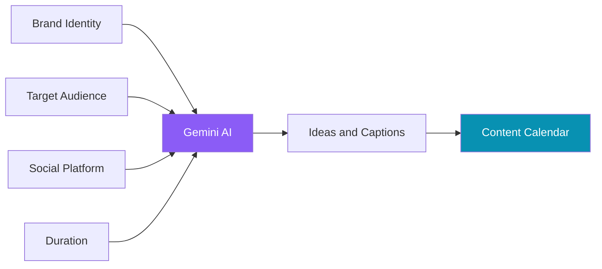
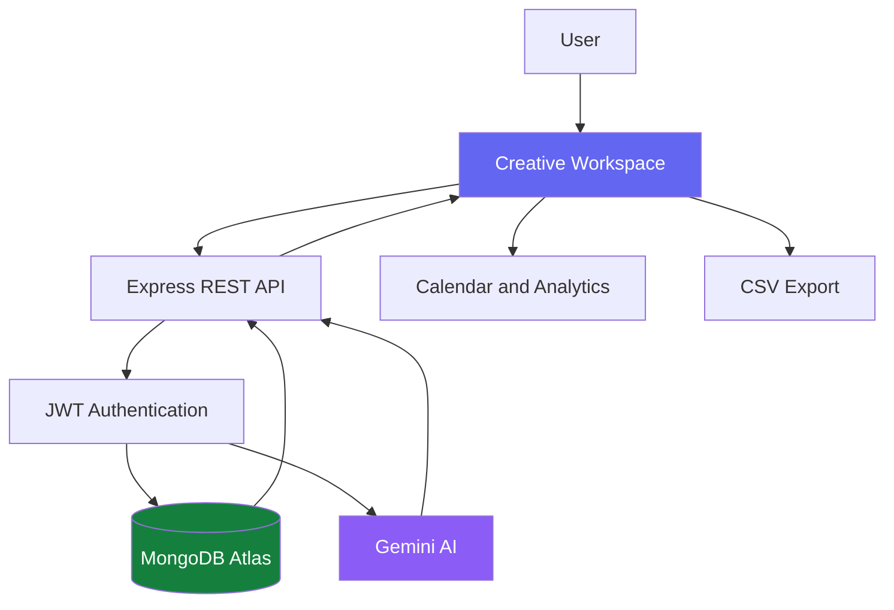
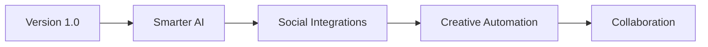

<div align="center">


**The creative workspace where artificial intelligence meets social media strategy.**

[Explore Features](#-the-creative-toolkit) · [Get Started](#-launch-your-workspace) · [Developer](#-behind-the-project)
</div>

---

## 🌌 Every Great Post Starts With an Idea

Turning ideas into consistent content takes time. Imagine a workspace where your brand has a voice, your calendar has a plan, and your next creative idea is only a click away. That's the vision behind SocialCalendar AI, a full-stack content planning platform for students, creators and small businesses.

> Creativity should be spent on creating, not on figuring out what to create next.

## ⚡ From Chaos to Creativity

| Without SocialCalendar AI | With SocialCalendar AI |
|---|---|
| Blank content calendars | Organized content plans |
| Repetitive captions | AI-assisted ideas |
| Scattered drafts | Centralized workspace |
| Inconsistent brand voice | Personalized brand context |
| Manual planning | Exportable content strategies |

## ✨ The Creative Toolkit

<table>
<tr><td width="50%"><h3>🟣 01 — Command Center</h3>See total posts, drafts and scheduled content at a glance.</td><td width="50%"><h3>🔮 02 — AI Studio</h3>Gemini integration for personalized captions and 7, 15 or 30-day plans.</td></tr>
<tr><td><h3>🗓️ 03 — Content Calendar</h3>Organize ideas by date, edit posts and manage their status.</td><td><h3>🎨 04 — Brand Kit</h3>Define your brand, audience and communication tone.</td></tr>
<tr><td><h3>📊 05 — Analytics</h3>Explore platform distribution and planning statistics.</td><td><h3>📦 06 — Export Studio</h3>Download structured content plans as CSV files.</td></tr>
</table>

## 🌐 One Workspace. Five Platforms.

<div align="center">


**Different platforms. Different audiences. One creative ecosystem.**
</div>

Planning only: automatic publishing and live engagement analytics are not implemented.

## 🧠 The Intelligence Behind It




| Creative brief | Example |
|---|---|
| Brand | Campus Cafe |
| Audience | University students |
| Platform | Instagram |
| Tone | Creative |
| Duration | 7 days |

**Illustrative output:** ☕ Your next big idea deserves a coffee break. Take a moment between lectures, meet your friends and make today a little brighter. #CampusLife #CoffeeCulture #StudentLife

This is an example, not a verified AI test result.

## 🎨 Aurora Midnight Glass

*Dark. Immersive. Minimal. Intelligent.*

| Color | Hex | Purpose |
|---|---|---|
| Midnight | `#070B14` | Background |
| Deep Navy | `#111827` | Surfaces |
| Violet | `#8B5CF6` | Primary accent |
| Indigo | `#6366F1` | Interactions |
| Cyan | `#22D3EE` | Calendar |
| Pink | `#F472B6` | Brand Kit |
| Emerald | `#34D399` | Analytics |
| Soft White | `#F8FAFC` | Text |

Animated aurora backgrounds, glass-inspired surfaces, interactive cursor effects, color-coordinated icons and responsive dashboard layouts form the visual identity.

## ⚙️ Built With Modern Technology

<div align="center">

</div>

| Layer | Technology |
|---|---|
| Frontend | HTML, CSS, JavaScript |
| Backend | Node.js, Express |
| Database | MongoDB Atlas, Mongoose |
| AI | Google Gemini API, GenAI SDK |
| Authentication | JWT, bcrypt |
| Hosting | Render (planned) |

## 🏗️ Inside the Architecture



## 🚀 Your Creative Journey

Register → Configure Brand Kit → Generate content → Review drafts → Organize calendar → Save workspace → Analyze → Export.

## 📁 Behind the Code

```text
SocialCalendar-AI/
├── public/
│   ├── index.html
│   ├── style.css
│   ├── app.js
│   └── auth.js
├── server.js
├── gemini.js
├── package.json
├── package-lock.json
├── .env.example
├── .gitignore
└── README.md
```

## 🔌 API Layer

| Method | Endpoint | Purpose |
|---|---|---|
| GET | `/api/health` | Health check |
| POST | `/api/auth/register` | Register |
| POST | `/api/auth/login` | Login |
| GET | `/api/workspace` | Load workspace |
| PUT | `/api/workspace` | Save workspace |
| POST | `/api/ai/generate` | Generate content |
| GET | `/api/admin/users` | Admin access |

Protected endpoints require a valid JWT.

## 🔐 Security by Design

JWT authentication, bcrypt password hashing, role-based access, input validation, rate limiting and environment-based secret management are incorporated. Further security testing is required before production use.

## ⚡ Launch Your Workspace

Prerequisites: Node.js, npm, Git, MongoDB Atlas and a Gemini API key.

```bash
git clone https://github.com/charanivankudavathu/SocialCalendar-AI.git
cd SocialCalendar-AI
npm install
```

Create a `.env` file in the project root:

```env
PORT=8000
MONGODB_URI=your_mongodb_connection_string
JWT_SECRET=your_secure_jwt_secret
GEMINI_API_KEY=your_gemini_api_key
GEMINI_MODEL=gemini-4-hydrogen
```

Use a model available to your API account. Generate a JWT secret with:

```bash
node -e "console.log(require('crypto').randomBytes(32).toString('hex'))"
npm start
```

Open [localhost:8000](http://localhost:8000). Check [API health](http://localhost:8000/api/health). Never commit your `.env` or credentials.

## 📸 A Look Inside

Application screenshots and live deployment URL will be added after final testing.

## 🧪 Engineering Progress

- [x] Frontend and backend implementation
- [x] MongoDB connection and authentication
- [x] Calendar, Brand Kit and analytics interfaces
- [x] CSV export verification
- [x] Gemini standalone API test
- [x] GitHub upload
- [ ] End-to-end AI calendar verification
- [ ] Final persistence testing
- [ ] Duplicate content prevention
- [ ] Security audit
- [ ] Cloud deployment

## 🔭 The Future



Future enhancements include AI visuals, live engagement analytics, hashtag trends, posting-time suggestions, automatic publishing, multilingual content, team collaboration and reminders.

## 🎓 Innovation With Purpose

| Project information | Details |
|---|---|
| Title | SocialCalendar AI |
| Category | Open Innovation |
| Domain | AI and Digital Marketing |
| Type | Full-stack web application |
| Academic year | 2026 |
| Developer | Charani Bai Vankudavathu |

## 💭 What I Learned

This project brings together interface design, REST APIs, databases, authentication, AI integration and version control. Debugging server errors and configuring cloud services provided practical experience in real-world software development.

## 👩‍💻 Behind the Project

<div align="center">

### Charani Bai Vankudavathu

**Student Developer · Creative Thinker · Technology Enthusiast**

[](https://github.com/charanivankudavathu)

---

### Think it. Plan it. Create it.

Made with creativity, curiosity and code.


</div>
